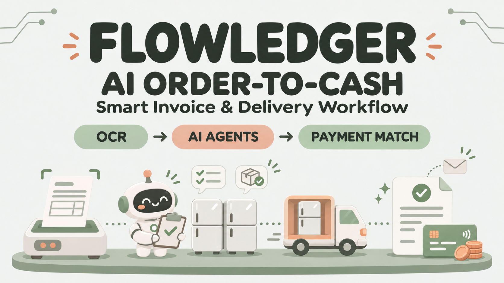
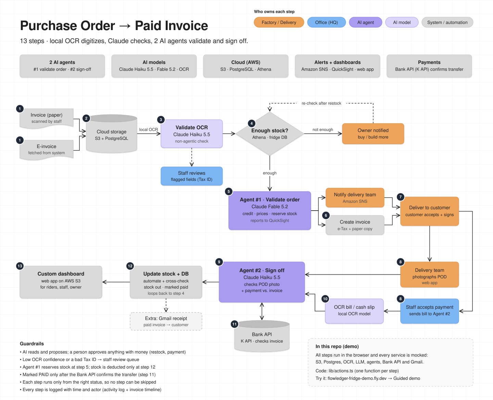

# FlowLedger: AI order-to-cash for a fridge distributor

**Paper invoice in, paid invoice out.** AI reads, checks and matches. People step in only
where a decision or money is involved.



**Live demo:** https://flowledger-fridge-demo.fly.dev  
**Course:** 2110582 AI Apps, bonus project (class: *AI and LS*)  
**Team:** Chatrphol (6730084521) and Thanabodhi (6733092021)

> [!NOTE]
> **Demo mode.** Every service is mocked in the browser: S3, Postgres, OCR, LLM, both
> agents, the Bank API and Gmail. Nothing leaves the page and no email is sent.

**Contents:**
[What it does](#what-it-does) ·
[Why it helps](#why-it-helps) ·
[Flow diagram](#flow-diagram) ·
[The 13 steps](#the-13-steps) ·
[How to use the demo](#how-to-use-the-demo) ·
[How the code works](#how-the-code-works) ·
[Run and deploy](#run-and-deploy) ·
[Demo vs. real system](#demo-vs-real-system)

---

## What it does

FlowLedger is the back office of a company that sells fridges to shops and hotels. It
follows one order the whole way:

1. **Read the order.** A paper invoice is scanned (or an e-invoice is fetched). OCR reads
   it and Claude checks the fields. A person fixes only what was flagged.
2. **Check and approve.** The system checks fridge stock. If stock is short, the owner
   decides whether to buy or build more. Then **Agent #1** checks the customer, credit
   and prices and approves the order.
3. **Deliver and prove it.** An invoice is created and the delivery team is told. The
   customer signs, the team photographs the signed note, and **Agent #2** checks the photo.
4. **Get paid and close.** Staff accept the payment, the AI matches it in the bank feed,
   stock and the database are updated, and the customer gets the paid invoice by email.

## Why it helps

### Highlights

| What FlowLedger does | What that changes |
|---|---|
| **Reads paper invoices for you.** A local OCR model reads the scan, then Claude checks the totals, the 7% VAT, the customer and the Tax ID. | Less typing. A misread such as the letter `O` in place of a zero is caught before it reaches the database. |
| **Asks a person only when it should.** In the guided demo a person acts 4 times: fix the Tax ID, approve the restock, sign, accept payment. | Staff spend their time on decisions, not data entry. |
| **Never ships what you don't have.** Stock is checked before the agent approves an order. A shortage goes straight to the owner. | No promises the warehouse can't keep. |
| **Shows its work.** Agent #1's tool calls (`get_customer`, `check_credit`, `match_prices`, `reserve_stock`, `decide`) are listed on screen. | Anyone can see *why* an order was approved. |
| **Checks proof of delivery.** Agent #2 looks for the signature, the invoice number and the item count on the delivery photo. | Fewer "we never got it" disputes. |
| **Pays only on a bank match.** An invoice is marked paid only after the matching transfer is found in the bank feed. | No invoice is closed on a promise. |
| **Keeps stock true.** Delivered fridges leave the same stock table that the stock check reads. | The next order is checked against real numbers. |
| **Logs everything.** Every step is written to the activity log and the invoice timeline, with the time and who did it (AI, Human, System, Gmail). | A full audit trail for every invoice. |

### Who it helps

- **Office staff (HQ):** review flagged fields instead of typing whole invoices; payments
  are matched for them.
- **Delivery team and riders:** get notified when an order is ready, collect the
  signature and photo in the web app, and see their jobs on the dashboard.
- **Owner and managers:** see at a glance what is waiting on a person, stock levels and
  money collected; get an alert when stock runs short.
- **Customers:** get a correct invoice, a delivery they signed for, and a receipt in
  their inbox.

---

## Flow diagram



Colours show who owns each step: **orange** = factory / delivery, **blue** = office
staff, **purple** = AI agent, **light purple** = AI model (no agent loop), **grey** =
system / automation. Dashed lines are side paths: staff review, restock re-check, and
the optional Gmail receipt. The source is [`docs/flow-diagram.svg`](docs/flow-diagram.svg).

---

## The 13 steps

The steps come from our design session on the whiteboard. The *Tools* column is the
real system we designed; the *Demo* column is what this repo runs today (all mocked,
see [Demo vs. real system](#demo-vs-real-system)).

### At a glance

| # | Step | Who | Tools (real system) | Demo: function → status |
|---|---|---|---|---|
| 1 | Scan a paper invoice, or fetch an e-invoice | Staff, System | Scanner, e-invoice system | `scanPaper()`, `fetchEInvoices()` → `stored` |
| 2 | Store the file and run OCR | System | Amazon S3, PostgreSQL, local OCR model | `makeOrder()` stores it, `extract()` reads it |
| 3 | Validate the OCR result, fix flags, save | AI model, Staff | Claude Haiku 5.5 (non-agentic), `POST /api/invoices` | `extract()` → `extracted`, `approve()` → `saved` |
| 4 | Check stock; restock if short | System, Owner | Amazon Athena, PostgreSQL (fridge DB) | `checkStock()` → `ready` or `short`, `restock()` |
| 5 | Validate the order | AI agent #1 | Claude Fable 5.2, QuickSight, Amazon SNS | `runAgent()` → `released` |
| 6 | Create the invoice, notify delivery | System | e-Tax invoice + paper copy, Amazon SNS | `createInvoice()` → `invoiced` |
| 7 | Deliver; customer accepts and signs | Delivery, Customer | Web app signature pad | `dispatch()` → `out`, `sign()` → `signed` |
| 8 | Photograph the delivery note; staff accept payment | Delivery, Staff | Web app (camera or upload) | `attachPhoto()`, `acceptPayment()` → `paid` |
| 9 | Validate the proof and sign off | AI agent #2 | Claude Haiku 5.5 | `validateProof()` → `proof_ok` |
| 10 | Read the cash bill / transfer slip | AI model | Local OCR model | *Not built yet* |
| 11 | Check the invoice against the bank | AI agent #2 | Bank API (e.g. KBank K API) | `matchBank()` → `matched` |
| 12 | Update stock and the database, cross-check | System | Automation, PostgreSQL | `updateStock()` → `closed` |
| 13 | Custom dashboard | Riders, Staff, Owner | Vibe-coded web app on AWS S3 | This Next.js app (hosted on Fly.io) |
| + | Email the paid invoice (extra) | Gmail | Gmail API | `compose()`, `sendEmail()` → `emailed` |

All functions are in [`lib/actions.ts`](lib/actions.ts).

### Step by step

#### Phase A: get the order in (steps 1–3)

**1 · Intake.** Staff scan paper invoices; e-invoices are pulled from the e-invoice system.
- *Demo:* in the left panel, press **Upload a scan**, **Sample scan**, or **Fetch e-invoices**
  (adds two). Paper invoices, sample or uploaded, take turns between Siam Appliance Co. and
  Lumpini Residence Hotel. Both have a Tax ID with a letter `O` where a zero should be, so you always see the
  review step.

**2 · Store and OCR.** The raw file goes to S3 and a record goes to Postgres. A local OCR
model reads the scan, so the original invoice never leaves our servers.
- *Demo:* each invoice gets an `INV-2041`-style number and an S3 path such as
  `s3://flowledger-demo/raw/INV-2041.jpg`. Paper is read by "local OCR" with a confidence
  score per field; e-invoices are parsed as XML at 100% confidence.

**3 · Validate the OCR (AI, non-agentic) and save.** Claude Haiku 5.5 checks the fields.
Anything it flags goes to a person, then the invoice is saved through the API.
- *Demo:* four checks run: line items add up to the subtotal, VAT is 7% of the subtotal,
  the customer is in the customer table, and the Tax ID is 13 digits. A bad Tax ID is
  flagged with a suggested fix. You type the fix (or press **Use AI suggestion**); the app
  won't save anything that isn't exactly 13 digits. Saving shows the
  `POST /api/invoices` body and a `201 Created` result.

#### Phase B: check and approve (steps 4–6)

**4 · Check stock.** Each order line is compared with the fridge stock table (Athena over
the database). If something is short, the owner is notified and decides to buy from a
supplier or order a production run. The check runs again after restocking.
- *Demo:* the warehouse starts with only 6 side-by-side fridges (`FR-SBS`), and the Siam
  Appliance order needs 9, so on a fresh start the first paper invoice is short. Restocking adds
  what is missing plus 20 units, then re-runs the check.

**5 · Agent #1 validates the order.** An AI agent (Claude Fable 5.2) uses tools to check
the customer, their credit, the prices and the stock, then decides. Results feed the
QuickSight dashboard and SNS alerts.
- *Demo:* the agent's trace is shown step by step:
  `get_customer` → `check_credit` (credit limit ฿1,500,000) → `match_prices` →
  `reserve_stock` → `decide` = **APPROVE**.

**6 · Create the invoice and notify delivery.** One event creates the e-Tax invoice and a
paper copy, and notifies the delivery team (Amazon SNS).
- *Demo:* the invoice document switches from the scan to the issued tax invoice; the
  notification is a mock push message.

#### Phase C: deliver and prove it (steps 7–9)

**7 · Deliver.** The truck goes out; the customer accepts the fridges and signs.
- *Demo:* press **Dispatch**, then sign on the pad with a mouse or finger (or let the
  guide sign for you).

**8 · Proof and payment.** The delivery team photographs the signed delivery note in the
web app. Office staff accept the payment and send the bill to Agent #2.
- *Demo:* **Upload a photo** or **Use sample photo** (a drawn delivery note). For payment,
  pick *Bank transfer*, *PromptPay* or *Cheque*; the amount is filled from the invoice
  total, and a matching transfer appears in the **Bank** tab as "waiting to be matched".

**9 · Agent #2 validates and signs off.** Claude Haiku 5.5 checks the delivery photo and
the payment against the invoice.
- *Demo:* the photo check lists four results: signature detected, invoice number readable,
  item count matches, photo time inside the delivery window. In the demo this runs
  *before* staff accept payment; the payment half of the check is step 11.

#### Phase D: get paid and close (steps 10–13)

**10 · Read the cash bill / slip.** A local OCR model reads the payment slip or cash bill
so Agent #2 can compare it with the invoice.
- *Demo:* **not built yet.** The amount comes from the invoice total, and the bank match in
  step 11 does the check.

**11 · Check the invoice with the bank.** Agent #2 calls the Bank API (for example KBank's
K API) to find the incoming transfer.
- *Demo:* the AI finds the open transfer for this invoice in the **Bank** tab and marks it
  matched. Nothing can be marked paid before this step.

**12 · Update stock and the database.** Delivered fridges are taken out of stock and the
invoice is marked paid. This writes to the same stock table that step 4 reads, which
closes the loop.
- *Demo:* the record shows each SKU's stock before and after; the **Inventory** tab drops
  by the same amount.

**13 · Custom dashboard.** A web app (vibe-coded, deployed on AWS S3) where riders, staff
and the owner see what is happening.
- *Demo:* this app is the dashboard. The top bar counts open invoices, invoices *waiting on
  you*, paid invoices and money collected. The left queue groups invoices into **Needs a
  person**, **In progress** and **Completed**. The right panel has **Activity**,
  **Inventory** and **Bank** tabs.

**Extra · Gmail receipt.** After closing, a receipt email is drafted with the paid invoice
attached. You can edit it and send it from a Gmail-style window (it is not really sent).
The invoice gets a **PAID** stamp.

---

## How to use the demo

### Quick start: the guided demo (about 5 minutes)

1. Open **https://flowledger-fridge-demo.fly.dev**, or [run it locally](#run-and-deploy).
   The first load after a quiet period takes a few seconds while the server wakes up.
2. Press **Guided demo** (top right) or **Start guided demo** on the welcome screen.
3. A bar at the bottom shows *Step n of 17*, what is about to happen, and one button.
   Press the button to run the step, **or** do it yourself in the step card. The guide
   follows either way and never moves on by itself.
4. You act yourself 4 times (amber **Your turn** cards): fix the Tax ID, approve the
   restock, sign, and accept the payment.
5. Keep an eye on the right panel: **Inventory** changes at the restock and at step 12;
   **Bank** shows the transfer go from waiting to matched.
6. Press **Reset** (top right) to start over.

| Guide step | What happens | Whiteboard step |
|---|---|---|
| 1 | Scan a sample paper invoice | 1–2 |
| 2 | OCR reads the scan, the LLM checks it | 2–3 |
| 3 | You fix the flagged Tax ID and save | 3 |
| 4 | Check stock (it is short) | 4 |
| 5 | You approve a restock (buy from supplier) | 4 |
| 6 | Agent #1 validates the order | 5 |
| 7 | Create the invoice, notify delivery | 6 |
| 8 | Dispatch | 7 |
| 9 | Customer signs | 7 |
| 10 | Photograph the delivery note | 8 |
| 11 | AI checks the photo | 9 |
| 12 | You accept the payment | 8 |
| 13 | AI matches it with the bank | 11 |
| 14 | Update stock and database | 12 |
| 15–16 | Draft and send the Gmail receipt | Extra |
| 17 | Paid and closed: the dashboard shows it as paid and collected | 13 |

### Free mode

Skip the guide and add invoices yourself from the left panel (**Upload a scan**, **Sample
scan**, **Fetch e-invoices**). Click any invoice in the queue to open it, then press the
button in its step card. You can run several invoices side by side and switch between them.

### What's on the screen

```
┌──────────────────────────── Top bar: open · waiting on you · paid · collected ───────────────┐
│ Queue (left)          │ Invoice (middle)                          │ Side panel (right)       │
│  Add invoices         │  Stage rail: 1 Intake … 8 Gmail invoice   │  Activity  (every step)  │
│  Needs a person       │  Step card: what to do next + button      │  Inventory (stock table) │
│  In progress          │  Record: fields, checks, agent trace, …   │  Bank      (bank feed)   │
│  Completed            │  Document + timeline                      │                          │
└───────────────────────┴───────────────────────────────────────────┴──────────────────────────┘
```

Each step card has a coloured tag that says who acts next: **AI step** (purple), **Your
turn** (amber), **System step** (blue) or **Gmail** (green). These are the app's own
colours; the flow diagram uses the colour key from our design.

The app groups the 13 steps into **8 stages** on the stage rail:

| App stage | Steps |
|---|---|
| 1 Intake | 1 |
| 2 Store | 2 |
| 3 Extract & validate | 2 (OCR), 3 |
| 4 Check stock | 4 |
| 5 Agentic decision | 5 |
| 6 Fulfil | 6, 7, 8 (photo), 9 |
| 7 Settle | 8 (payment), 11, 12 |
| 8 Gmail invoice | Extra |
| *whole screen* | 13 |

---

## How the code works

Everything runs in the browser. There is no backend and there are no API keys.

- **One function per step.** Each "service" in [`lib/actions.ts`](lib/actions.ts) is a short
  delay plus a state change, named after the real step it stands in for.
- **Steps can't be skipped.** Every action starts with `ready(id, ...statuses)`, which
  only lets it run when the invoice is in the right status and not already busy.
- **Who acts next is data.** `NEXT` in [`lib/data.ts`](lib/data.ts) maps each status to an
  actor (AI, Human, System, Gmail) and a task. The queue groups, the *waiting on you*
  count and the step-card colours all come from it.
- **Everything is logged.** `log()` writes each event to the activity log and to the
  invoice's own timeline, with the time and the actor.
- **Small store.** [`lib/store.ts`](lib/store.ts) holds the state; components re-render
  through React's `useSyncExternalStore`.

An invoice moves through these statuses:

```
stored → extracted → saved → [short → restock →] ready → released → invoiced
       → out → signed → proof_ok → paid → matched → closed → emailed
```

### Code map

| File | What's in it |
|---|---|
| [`lib/actions.ts`](lib/actions.ts) | The mock services: one function per pipeline step |
| [`lib/guide.ts`](lib/guide.ts) | The 17-step guided demo |
| [`lib/data.ts`](lib/data.ts) | Fridge catalog, customers, statuses, stages, starting stock, bank feed |
| [`lib/store.ts`](lib/store.ts) | In-browser state |
| [`lib/types.ts`](lib/types.ts) | Types for orders, statuses, bank transactions, log entries |
| [`lib/format.ts`](lib/format.ts) | Baht formatting, totals and VAT, the email draft |
| [`lib/canvas.ts`](lib/canvas.ts) | Draws the sample delivery photo and the demo signature |
| [`components/`](components/) | UI: top bar, queue, step card, record, document, side panel, signature pad, Gmail window, guide bar |
| [`docs/flow-diagram.svg`](docs/flow-diagram.svg) | The flow diagram above |

Built with Next.js 16, React 19 and TypeScript.

---

## Run and deploy

### Run locally

```bash
npm install
npm run dev        # http://localhost:3000
npm run typecheck  # TypeScript check
npm run build      # static site in out/
```

### Deploy (Fly.io)

The app builds to static files (`output: "export"`) served by nginx. Config is in
[`fly.toml`](fly.toml), [`Dockerfile`](Dockerfile) and [`nginx.conf`](nginx.conf). The
machine sleeps when idle and wakes on the next visit, so the first load after a quiet
period takes a few seconds.

```bash
fly auth login
fly deploy --remote-only --ha=false
```

Because the build is plain static files in `out/`, the same files can also be hosted
from an S3 bucket, which is where step 13 plans to put the dashboard.

---

## Demo vs. real system

| Part | Real system (designed) | In this demo |
|---|---|---|
| File storage | Amazon S3 | An S3 path string only |
| Database | PostgreSQL | In-browser store |
| Paper OCR (step 2) | Local OCR ML model | Fixed fields with confidence scores and a built-in misread |
| OCR check (step 3) | Claude Haiku 5.5, non-agentic | Four rule checks |
| Stock query (step 4) | Amazon Athena over the fridge DB | In-browser stock table |
| Agent #1 (step 5) | Claude Fable 5.2 with tools | Scripted tool calls |
| Notifications | Amazon SNS | On-screen "mock push" message |
| Agent #2 (step 9) | Claude Haiku 5.5 | Four scripted photo checks |
| Slip OCR (step 10) | Local OCR ML model | Not built yet |
| Bank (step 11) | Bank API, e.g. KBank K API | In-browser bank feed |
| Dashboards (step 13) | QuickSight + custom web app on AWS S3 | This app, on Fly.io |
| Email (extra) | Gmail API | Gmail-style window; nothing is sent |

All customers, invoices, Tax IDs and bank transactions in the demo are made up.
